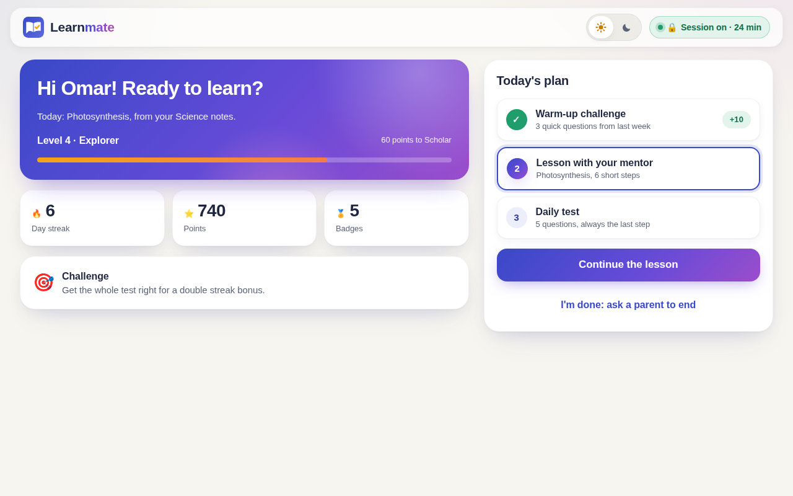
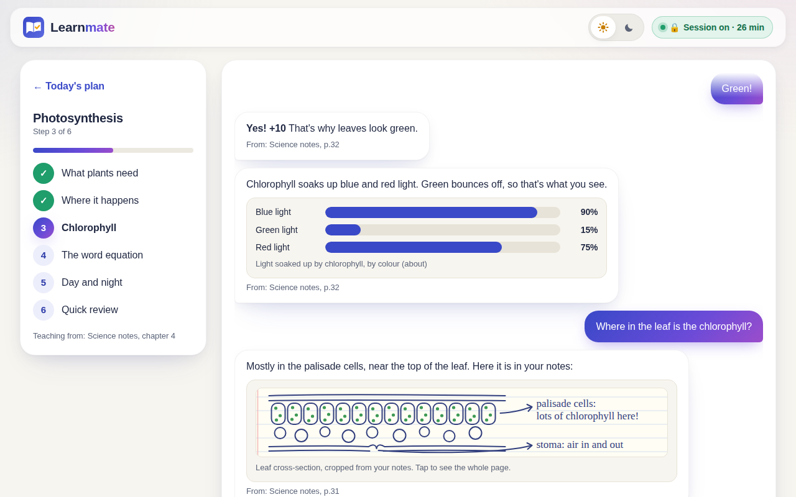
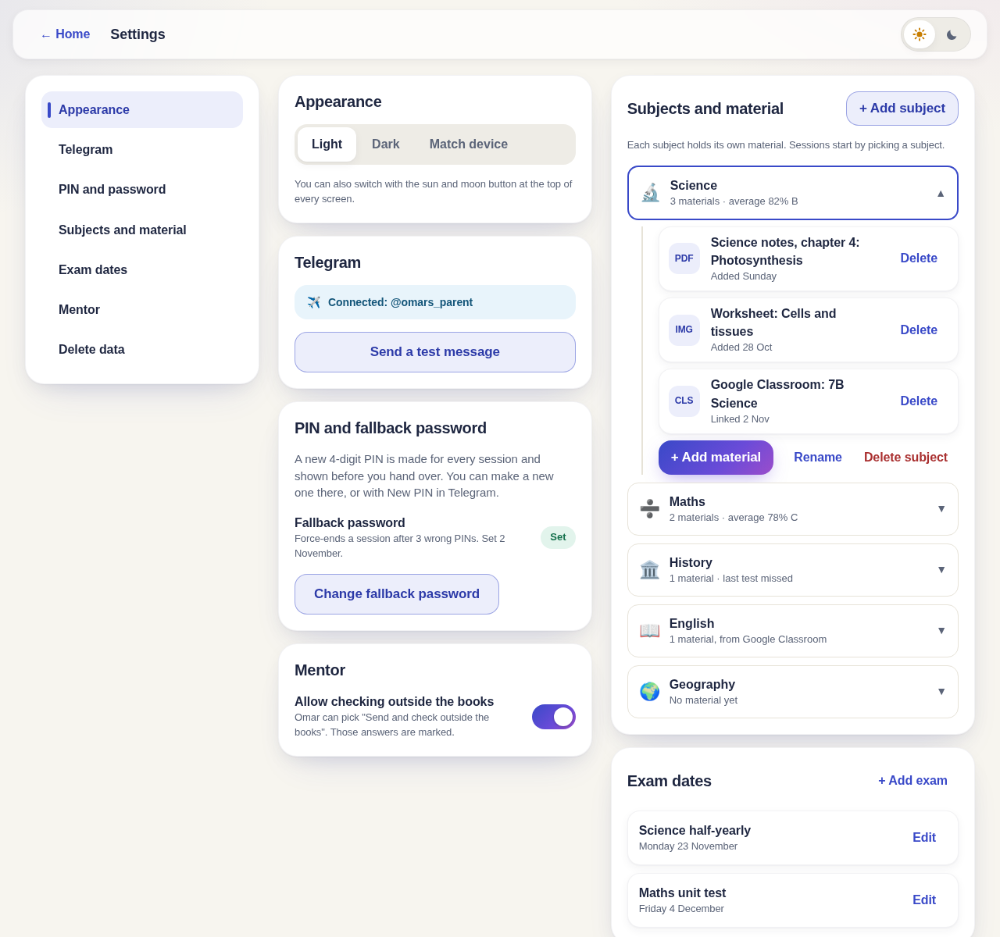
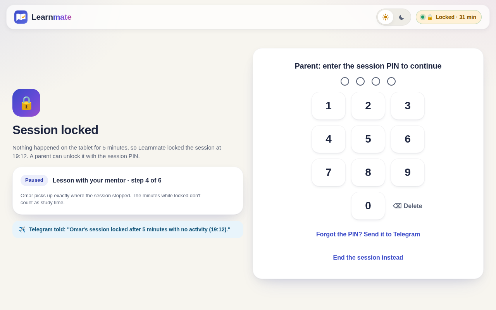

<!-- about -->
# Learnmate

**A parent-supervised daily study mentor that teaches from your school syllabus and reports every test**

## Screens

### S01 · Parent home

See whether today's study happened and start a session

### S02 · Todays Material

### S03 · Hand over

Confirm the session, note the session PIN and hand the device over

### S04 · Session home

The student sees today's plan and their progress, and continues

### S05 · Mentor

Learn today's topic step by step and ask questions

### S06 · Test

Answer the session's test questions

### S07 · Test result

See the score, what to review and the rewards earned

### S08 · End session (parent PIN)

A parent ends the session with the session PIN, or force-ends it with the fallback password as a last resort

### S09 · Settings

Manage appearance, Telegram, the PIN and fallback password, subjects and their material, exam dates and the mentor

### S11 · Session locked

Lock the session after 5 minutes with no activity, until a parent unlocks it with the session PIN

<!-- /about -->

## Development

TODO: build and test instructions, added with the first code.

---

Created with ❤️ by Dunder Mifflin agents
