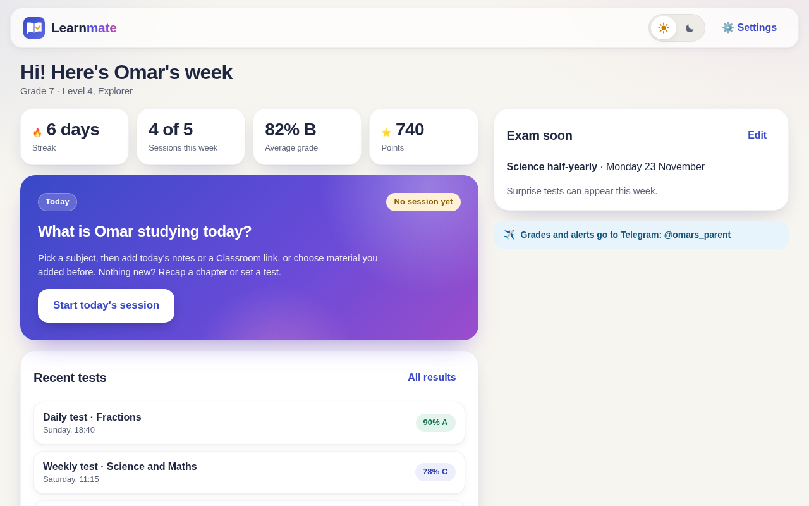
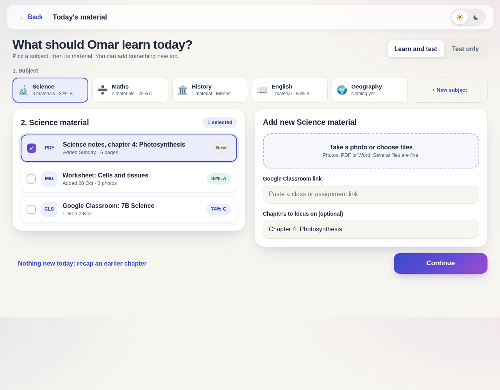
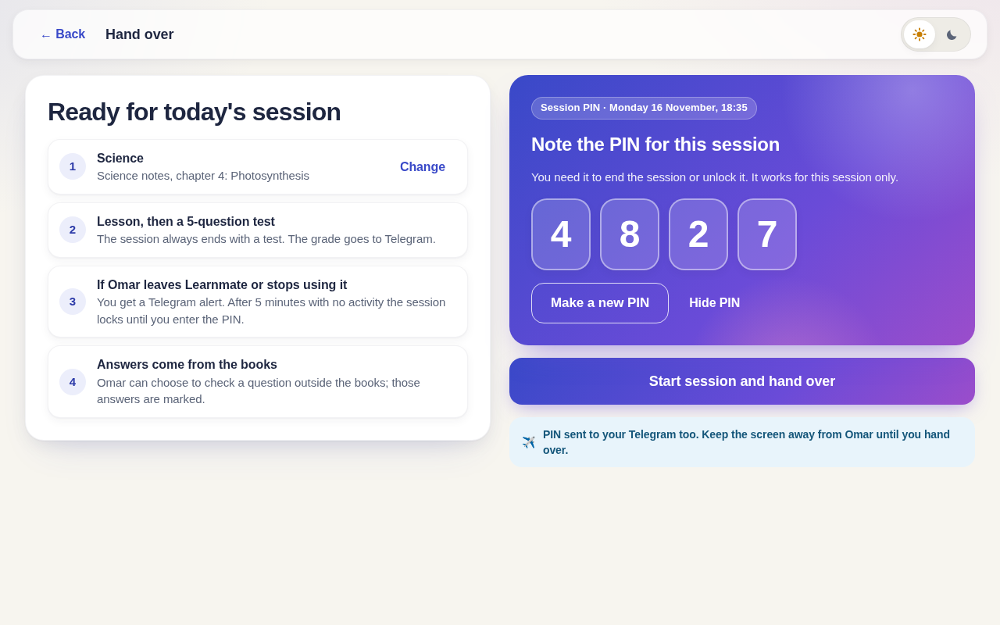
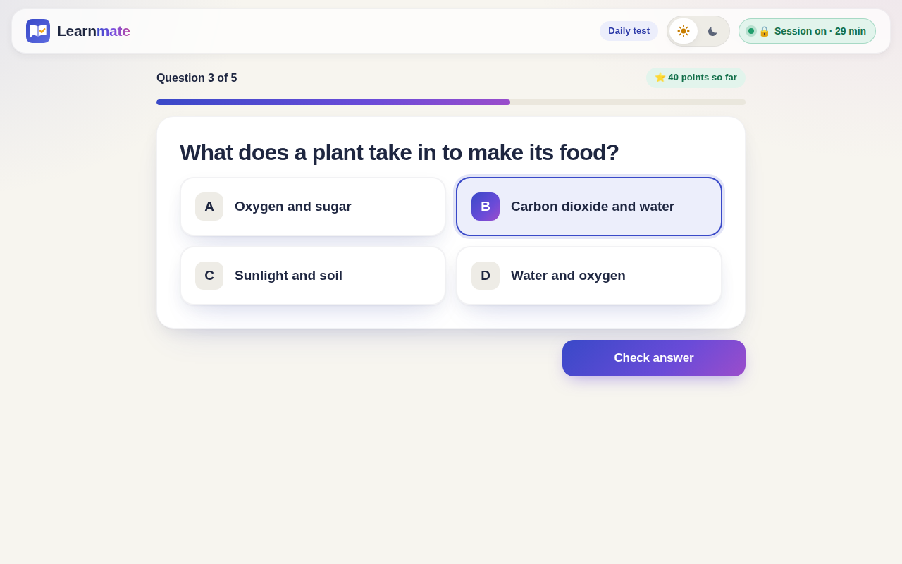
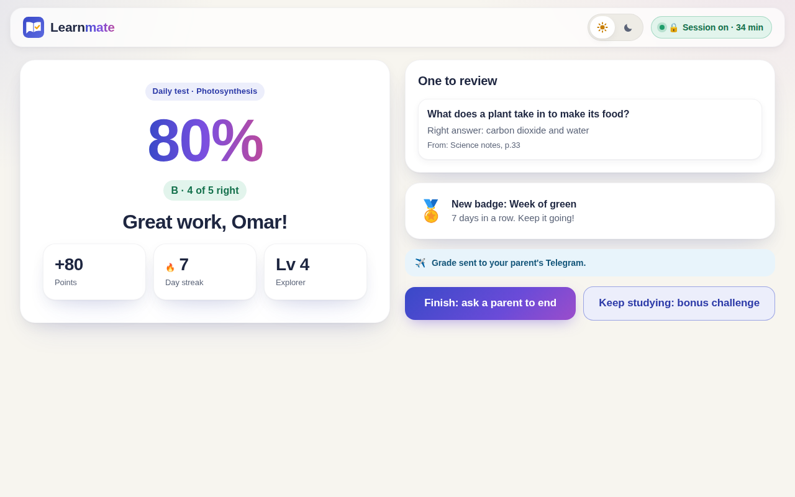
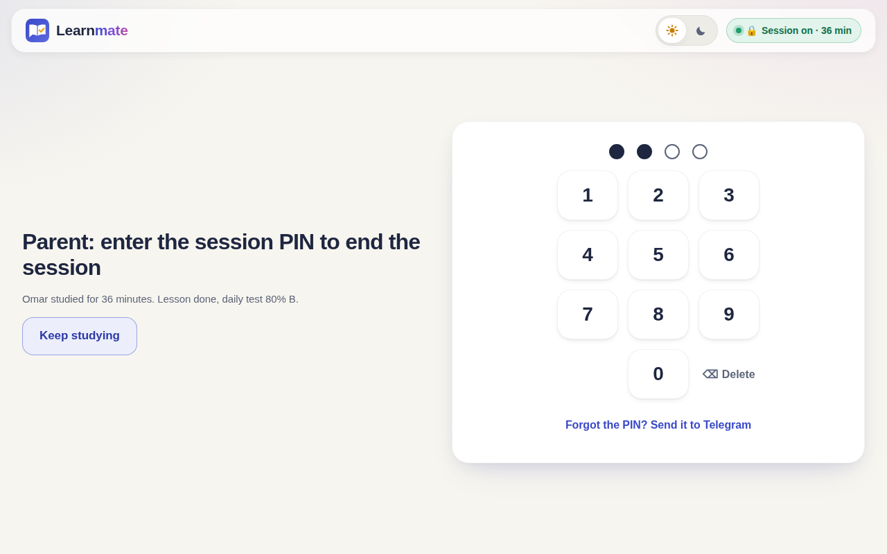

<!-- about -->

# Learnmate

**A parent-supervised daily study mentor that teaches from your school syllabus and reports every test**

## Screens

### S01 · Parent home

See whether today's study happened and start a session



### S02 · Todays Material



### S03 · Hand over

Confirm the session, note the session PIN and hand the device over



### S04 · Session home

The student sees today's plan and their progress, and continues


### S05 · Mentor

Learn today's topic step by step and ask questions


### S06 · Test

Answer the session's test questions



### S07 · Test result

See the score, what to review and the rewards earned



### S08 · End session (parent PIN)

A parent ends the session with the session PIN, or force-ends it with the fallback password as a last resort



### S09 · Settings

Manage appearance, Telegram, the PIN and fallback password, subjects and their material, exam dates and the mentor


### S11 · Session locked

Lock the session after 5 minutes with no activity, until a parent unlocks it with the session PIN


<!-- /about -->

## Development

### Server (`server/`)

Needs Python 3.14.

```sh
cd server
python3.14 -m venv .venv && . .venv/bin/activate && pip install -e ".[dev]"
alembic upgrade head                                    # migrate
uvicorn learnmate.main:create_app --factory --reload   # run
uvicorn learnmate.main:create_app --factory --reload --host 0.0.0.0   # run, reachable from a tablet on the LAN
pytest                                                  # test
python -m learnmate.rag.reindex                          # re-embed every chunk with EMBED_MODEL (run after changing it)
pytest tests/ingest --real                              # read real pages under data/eval/real/ with the real model (needs ANTHROPIC_API_KEY); output in data/eval/real/out/
pytest tests/rag                                        # retrieval eval (with EMBED_CACHE_DIR set): prints recall@6 and MRR, fails below 0.85
pytest tests/rag --real                                 # also the real set in data/eval/real/ (needs ANTHROPIC_API_KEY); see docs/retrieval-eval.md
python tests/rag/eval/make_photos.py                    # regenerate the eval notebook photos
python tests/ingest/make_fixtures.py                    # regenerate the ingest fixtures
# API calls need the header `Authorization: Bearer <DEVICE_TOKEN>` (only `/api/v1/health` is open)
ruff format . && ruff check --fix .                     # format
ruff format --check . && ruff check .                   # check
```

The database is `learnmate.db` in `DATA_DIR`.

Settings come from the environment:

| Variable                 | Meaning                                                 | Default                                |
| ------------------------ | ------------------------------------------------------- | -------------------------------------- |
| `DATA_DIR`               | Where the database and files are kept                   | `data`                                 |
| `DEVICE_TOKEN`           | Token the app sends on every request                    | empty                                  |
| `MODEL_MAIN`             | Model for lessons, answers and tests                    | `claude-sonnet-5-5`                    |
| `MODEL_FAST`             | Model for page reading and rewriting                    | `claude-haiku-4-5-20251001`            |
| `ANTHROPIC_API_KEY`      | Key for the AI provider                                 | empty                                  |
| `LLM_PROVIDER`           | `anthropic`, or `fake` for offline runs                 | `anthropic`                            |
| `EMBED_MODEL`            | Embedding model                                         | `BAAI/bge-small-en-v1.5`               |
| `EMBED_PROVIDER`         | `fastembed`, or `fake` for offline runs                 | `fastembed`                            |
| `EMBED_CACHE_DIR`        | Where downloaded model files are kept                   | fastembed's default                    |
| `RERANK_ENABLED`         | Turn on result re-ranking                               | `false`                                |
| `RAG_MIN_SIMILARITY`     | Relevance floor for search (see docs/retrieval-eval.md) | `0.53` (tuned for `bge-small-en-v1.5`) |
| `LLM_MONTHLY_BUDGET_USD` | Monthly AI spending cap                                 | `10`                                   |
| `LLM_PRICES`             | USD per million input/output tokens per model, as JSON  | Sonnet 3/15, Haiku 1/5                 |
| `LLM_WEB_SEARCH_USD`     | Price of one web search                                 | `0.01`                                 |

Chunks are embedded on the server with `EMBED_MODEL`. After changing it, run `python -m learnmate.rag.reindex`; start-up also re-embeds any chunk made with a different model. `tests/rag/test_fastembed_real.py` runs only when `EMBED_CACHE_DIR` is set; it downloads the model (about 70 MB) once.

The Telegram bot only starts when `TELEGRAM_BOT_TOKEN` is set (messages wait in the outbox until then); tests never need it. Times in messages use `TIMEZONE` (an IANA name, default `UTC`). The month for the AI budget follows `TIMEZONE`; alerts go to Telegram at 80% and 100%, once each per month.

Every product default in `server/learnmate/config.py` (PIN rules, lockouts, inactivity limits, grade bands) can be overridden by its upper-cased name, e.g. `PIN_LENGTH=6`.

### Android (`android/`)

Needs JDK 17 and the Android SDK.

```sh
cd android
./gradlew assembleDebug                 # build
./gradlew testDebugUnitTest             # test
./gradlew ktlintFormat                  # format
./gradlew ktlintCheck                   # check
./gradlew recordRoborazziDebug          # record screenshots
./gradlew verifyRoborazziDebug          # verify screenshots
```

Screenshots are stored in `app/src/test/screenshots`.

#### Classroom check (debug builds only)

A debug-only screen that checks whether a Google account can grant read-only Classroom and Drive access. Add your Android OAuth client id to `android/local.properties`:

```
google.androidClientId=<your Android OAuth client id>
```

#### Server connection

Add the server address and device token to `android/local.properties`:

```
learnmate.serverUrl=http://192.168.1.20:8000
learnmate.deviceToken=<same value as the server's device token in .env>
```

Use the tunnel's `https://` hostname for a real install. A plain `http://` address (a LAN server) works only in debug builds.

See `docs/classroom-check.md` for the procedure and results.

### Docs (repo root)

```sh
npm install
npx prettier --write .   # format
npx prettier --check .   # check
```

### CI

GitHub Actions runs three jobs on every pull request: `server`, `android` and `prettier`.

---

<sub>Created with ❤️ by Dunder Mifflin agents</sub>
